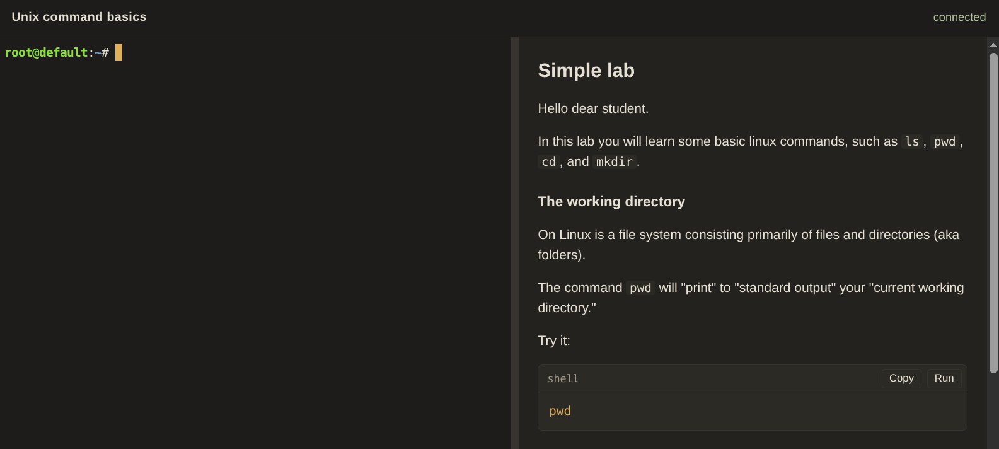

# A lab

[runlab](https://runlabs.io) lets learners take a lab right in their web browser, so they don't need to install anything on their own computer. This manual shows you how to write a lab, publish it, and invite learners to take it.

A lab page has two parts. The lesson holds the instructions, and beside it is a shell: a prompt on a Linux machine that was prepared for that lesson. The banner at the top of the page shows the lab's title.

<figure markdown="1">
{ width="720" }
</figure>

The learner types commands into the shell. You can also put a button in the lesson that runs a command for them, or a link that opens a page the machine is serving.

A small lab might only ask the learner to run `pwd`, `ls`, `mkdir`, and `cd`, but a larger lab can do much more. A Kubernetes lesson, for example, can start a small cluster on the machine and then ask the learner to use it. The examples in this manual are deliberately small, because they're meant to show the pieces of a lab one at a time.

When the learner is finished, they press Complete lab, which closes the lab.

Before you publish a lab, you try it on your own computer. The next page shows you how.
